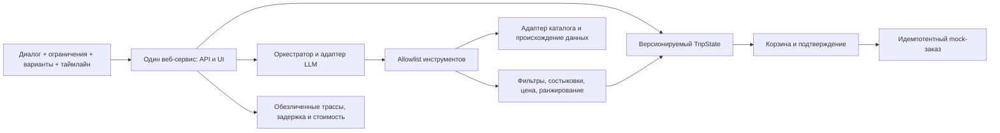

# Проект архитектуры · draft
Это описание будущей реализации, не созданный runtime.

## Границы ответственности
- LLM: извлечение намерения/ограничений, выбор допустимого инструмента, точечное уточнение, понятное объяснение на основе фактов.
- Оркестратор: схема вызова, лимит шагов/времени/стоимости, переходы состояний и обработка ошибок. Модель не исполняет произвольный код, URL или SQL.
- Доменный слой: полная цена, соответствие состава группы, дат, бюджета, временных буферов, отмены и предпочтений. Невыполнимые варианты отсекаются до ранжирования.
- Адаптеры: направления, размещение, транспорт, трансфер и данные о погоде. Возвращают идентификаторы, тип данных, единицы и provenance. Внешний текст — данные, не инструкция агенту.
- TripState: подтверждённые/предположенные ограничения, выбранные компоненты, версия и история изменений. Изменение входа инвалидирует зависимые варианты и старую корзину.
- Checkout: проверка версии и ограничений перед явным подтверждением. Только синтетический заказ; ключ идемпотентности исключает дубликаты. Реальная оплата отсутствует.

## Инструменты и переходы
Предлагаемые инструменты: parse_request, suggest_destinations, search_hotels, search_transport, search_transfers, validate_trip, rank_options, update_constraints, build_cart, confirm_mock_order. parse_request может быть частью LLM-адаптера, а validate_trip всегда доменный код.

Переходы: draft → needs_clarification → searching → options → selected → validated_cart → confirmed_mock. Ошибки empty_results, invalid_constraints, provider_timeout, stale_cart ведут к явному восстановлению или вопросу. Подтверждение не вызывается автоматически из текста данных или ответа модели.

Минимально необходимые API:POST/api/sessions;POST/api/sessions/{id}/messages;PATCH/api/sessions/{id}/constraints;POST/api/sessions/{id}/cart;POST/api/sessions/{id}/confirm;GET/health. Это предлагаемые контракты, не существующие маршруты. Для изменений и checkout передаётся expected_version. Сессии изолируются; наружу не выводятся ключи провайдера.

## Отказы и наблюдаемость
Задаём на технической пробе лимиты LLM-вызовов, таймаут источника, общий deadline и бюджет. В логах request_id, tool, latency_ms, input/output_tokens, success, error_code, data_version и model_id; личный текст не хранится по умолчанию. Недоступность модели — видимая ошибка с сохранённым состоянием и возможностью повторить; записанный ответ не выдаётся за live-работу. Синтетический каталог позволяет воспроизводить данные без доступа к реальному инвентарю, но не заменяет проверку агентского поведения.

Одно приложение на 8080, статические ресурсы локальны, SQLite/JSON без отдельного сервера. Дополнительные сервисы добавляем лишь при подтверждённой необходимости. Docker-образ multi-stage и non-root; автоматическое сидирование. Если появится внешняяБД, Compose ждёт service_healthy, а не только запуск процесса. Основание:T01–T03 в docs/sources.md.
