# План по датам · МСК

Работу исполняют агенты, человек проверяет своё направление. Окна предварительные и не являются календарными бронированиями. Агент-часы не равны человеко-часам. Другие кейсы не изменялись.

| Дата | Фокус | Агент-часы |
|---|---|---:|
| 2026-10-23 | Доступы; источники и план уже готовит ассистент | 1.25 |
| 2026-10-24 | Требования, ценность, контракты | 5.5 |
| 2026-10-25 | Данные, дизайн, тест-план, экономика | 7 |
| 2026-10-26 | Каркас, адаптеры, модель | 8.5 |
| 2026-10-27 | Основная реализация и интеграция | 23 |
| 2026-10-28 | Исправления, доказательства, демо и сдача | 15 |
| 2026-10-29 | Резерв и приём | 0.5 |
| 2026-10-30 | Проверка отбора и условный финал | 2 |

Всего: 62.75 агент-часов, включая условные задачи финала. Проверка человеком: danya: 1.35 ч, misha: 1.20 ч, maxim: 2.25 ч, kirill: 0.60 ч. Это предварительные оценки, не подтверждённые часы занятости.

```mermaid
flowchart LR
  A[23: источники и доступы] --> B[24: границы и контракты]
  B --> C[25: данные, дизайн, тест-план]
  C --> D[26: каркас и провайдер]
  D --> E[27: независимые модули]
  E --> F[27 вечер: интеграция и тест]
  F --> G[28: исправления, демо, проверка]
  G --> H[28 до 20:00: отправка]
  H --> I[29 до 10:00: официальный срок]
```

Основной объём на 27–28 октября соответствует поручению Максима. Для параллельных модулей 27 октября нужны независимые агенты и ветки. Данные и контракты фиксируются заранее. При блокере агент обновляет карточку с фактической причиной. Прогноз не является готовностью. Внешняя отправка и принятие приглашений требуют владельца аккаунта или доступного авторизованного инструмента.
